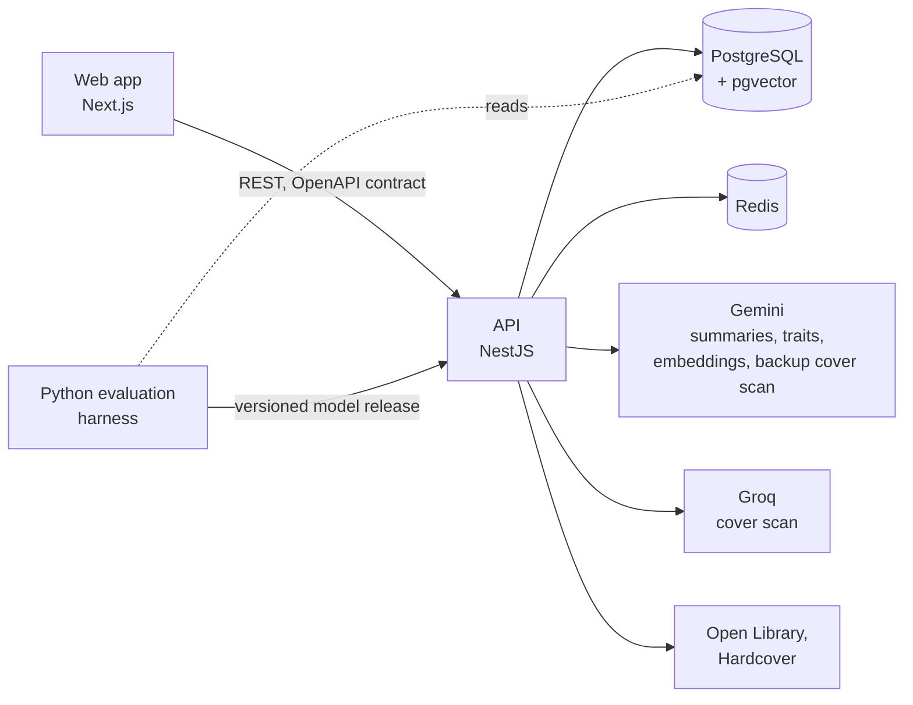
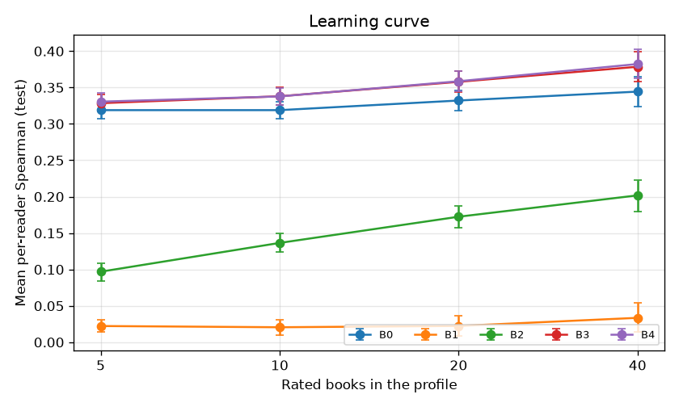
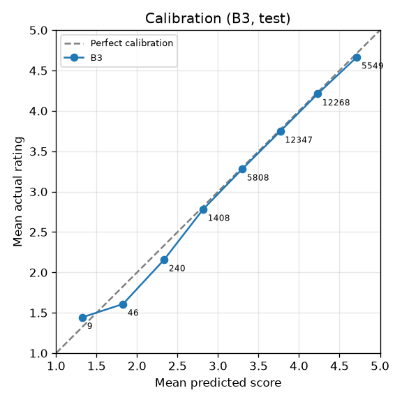

# Bookie

Bookie helps a reader decide whether to read a book. They type a title or photograph the cover, and the app shows three signals, always kept apart:

- **Public reception:** what reviewers say, summarized by an LLM, where every claim cites the review it comes from.
- **Personal match:** how much this reader is likely to like the book, predicted from their own ratings by a model evaluated against baselines. It is shown on a 1 to 5 scale and is not a probability of enjoyment.
- **Evidence confidence:** how much evidence stands behind each of the two, computed in code, never by the LLM.

The evaluation is part of the product: every number below has a baseline, a method, a seed and an interval, and the [results](#results) include what did not work.

> **Status.** Every app feature is built. Three evaluation steps are still open, all limited by the free Gemini tier: the large-model comparison, the claim-faithfulness check, and the final offline run once every evaluation book has traits. Details in [`docs/STATUS.md`](docs/STATUS.md).

## Features

- **Accounts:** email and password sign-up, sign-in and password reset, written from scratch (no auth provider).
- **Taste capture:** import a Goodreads or StoryGraph export, quick-rate popular books, or answer an optional questionnaire. A personal match needs at least 3 rated books.
- **Discovery:** search by title (falling back to Open Library when the catalog has no good match), or photograph a cover with the in-app camera or pick a saved photo (read by a Groq vision model, with Gemini as the backup), then confirm the edition. Photos are never stored.
- **Result screen:** the public reception with clickable citations, ratings from live sources (Open Library, Hardcover), the personal match with the reader's most similar rated books as reasons, and a confidence level for each.
- **Feedback:** "Accurate" or "Not for me" on each result, stored as labelled data.
- **History, reading list and comparison:** past results with timestamps and model versions, a reading list ranked by personal match, and a side-by-side comparison of two books.
- **Settings:** delete all of my data.
- **User study:** an in-app study flow and report (built; no participants yet).

## How it works



- **Analysis pipeline.** An analysis runs as eight background steps that store their output, so a retry reruns only what failed and a restart resumes where it stopped. A source that fails is reported as failed, never as "no criticism found".
- **LLM safety.** Review text is untrusted: it is delimited in the prompt, instructions inside it are ignored, and it is shown as plain text. Every claim must cite a real review, which the code checks; invalid output is retried once, then the step fails.
- **Cover scan.** Groq (`qwen/qwen3.8-27b`) reads the photo first and Gemini is the backup, so scans do not use the Gemini quota that analyses need. The model only reports what is printed; code decides from catalog match scores whether a scan is identified or goes to the reader to confirm. The photo stays in memory and is never stored. The in-app camera (webcam on a laptop, back camera on a phone) sends the frame as taken, with no clean-up. In informal checks, Groq read clear cover photos and declined blurry webcam frames with low certainty instead of guessing a title; the reader is then asked to type it. Accuracy on a labelled photo set is not measured yet ([D-030](docs/DECISIONS.md)).
- **Caching.** A book's public reception is built once and reused by every reader for 30 days. Readers asking for the same book at the same time share one build, and model output is reused when the evidence has not changed. A failed rebuild falls back to the older reception, labelled with its date.
- **Models.** Trained and evaluated in Python, exported as a versioned release, and scored by the API in TypeScript. A parity test checks that both languages give the same scores (within 1e-6), so the app runs exactly the model that was evaluated.
- **Contract.** Request and response shapes are zod schemas in the API, published as `contract/openapi.json`; the web app's types are generated from it, and its tests mock the API with the contract's fixtures.

**Stack:** TypeScript, Next.js (App Router), NestJS, Prisma, PostgreSQL with pgvector, Redis, Python (NumPy, SciPy), Gemini API, Groq API, Docker Compose, GitHub Actions.

## Results

### Personal match (offline evaluation)

Five models predict 5,000 Goodreads readers' held-out ratings of the 982 most-rated books (one edition per work). The models learn from 1.58M ratings by 268,832 other readers; each evaluated reader is split 20% test, 20% validation and the rest as their profile. Mean per-reader metrics on the **test** split, with 95% bootstrap intervals over readers (1,000 resamples):

| Model | Spearman (higher is better) | NDCG@10 | MAE in stars (lower is better) |
|---|---|---|---|
| B0 The book's average rating (baseline) | 0.319 [0.307, 0.331] | 0.896 [0.892, 0.899] | 0.788 [0.779, 0.796] |
| B1 Questionnaire and trait match (the v1 approach) | 0.033 [0.022, 0.044] | 0.841 [0.838, 0.844] | 0.806 [0.796, 0.814] |
| B2 Taste vector from book embeddings | 0.183 [0.170, 0.195] | 0.872 [0.868, 0.875] | 0.775 [0.766, 0.783] |
| **B3 Item-based collaborative filtering (shipped)** | **0.353 [0.341, 0.365]** | **0.903 [0.900, 0.906]** | **0.710 [0.702, 0.718]** |
| B4 Hybrid of B2 and B3 | 0.356 [0.344, 0.368] | 0.904 [0.901, 0.906] | 0.714 [0.706, 0.722] |

- **B3 beats the baseline:** +0.035 Spearman [0.027, 0.042] and 0.078 fewer stars of error [0.073, 0.083], about 10% lower MAE (paired over readers).
- **Why B3 and not B4:** the shipped model is chosen on validation Spearman only. B3 and B4 are level there (0.3592 against 0.3589), and the simpler model wins the tie.
- **Interim run:** 344 of the 982 books had LLM-extracted traits. Only B1 and the traits ablation use traits; the final run after every book has them will update those two.

Full report, validation numbers, ablations and method: [`eval/results/offline/report.md`](eval/results/offline/report.md).

**Learning curve.** B3 is above the baseline from 5 rated books and gains with more: Spearman 0.328 at 5 books, 0.338 at 10, 0.358 at 20 and 0.379 at 40.



**Calibration of the shipped model.** Expected calibration error 0.025 stars: predictions in each half-star bin land within about 0.2 stars of the actual average rating.



### LLM trait extraction

The small model (`gemini-3.5-flash-lite`, what the app uses) labels each book's pace, tone, content intensity and themes from its description and reviews. It is scored against hand labels on 100 books (a seeded sample of the 5,000 most-rated), next to the score of always giving the most common hand label:

| Trait | Metric | Small model | Always the most common label |
|---|---|---|---|
| Tone (8 choices) | accuracy | **0.68 [0.58, 0.77]** | 0.24 |
| Pace (3 choices) | accuracy | 0.52 [0.43, 0.62] | 0.57 |
| Content intensity (3 choices) | accuracy | 0.39 [0.30, 0.48] | 0.49 |
| Themes (up to 5 of 17) | macro-F1 | 0.56 [0.49, 0.61] | |
| Themes | Jaccard per book | 0.44 [0.41, 0.49] | |

- Pace and intensity answers are within one step of the label on 97 and 95 books, but the model rates content intensity **lower** than the label on 60 of its 61 misses.
- 98 of 100 answers were valid on the first try and none failed. Cost: $0.0034 per book at list prices.
- One labeller, so there is no agreement figure between people. The larger model has not yet answered all 100 books (20 free requests a day), so there is no small-against-large comparison yet.

Report: [`eval/results/llm/report.md`](eval/results/llm/report.md). Labelling instructions and the committed labels (IDs and labels only, no review text): [`eval/llm/`](eval/llm/).

### Summary faithfulness

**Not measured yet.** The pipeline already checks in code that every claim cites a review that exists, and in the latency benchmark 40 of 40 model responses passed on the first try. Whether the cited review actually supports the claim is judged on a sample of 100 claims by a stronger model, which waits for free-tier quota.

### Cost and latency

Measured on 20 never-analysed books (cold), then the same books again (cached), with real Gemini on the free tier. Medians and 95th percentiles with 95% bootstrap intervals:

| Measure | Value |
|---|---|
| Cold analysis, p50 / p95 | 11.2 s [8.2, 12.8] / 14.9 s [13.0, 15.7] |
| Cold analysis without free-tier pacing, p50 / p95 | 5.4 s / 6.9 s |
| Cached analysis, p50 / p95 | 0.2 s [0.2, 0.3] / 1.5 s [0.4, 1.6] |
| Model calls per cold analysis | 2 (summary and traits, run in parallel) |
| Tokens per cold analysis | 16,801 input, 802 output |
| Cost per cold analysis, at list prices | $0.0070 (the same tokens on `gemini-3.8-flash`: $0.0156) |
| Model responses valid on the first try | 40 of 40 |

Other jobs shared the model's per-minute quota during the run, so the pacing wait may be overstated; model time is not affected. Report: [`eval/results/live/cost-latency.md`](eval/results/live/cost-latency.md).

### Hypotheses

| | Hypothesis | Result |
|---|---|---|
| H1 | The learned model beats the average-rating baseline | **Supported:** B3 +0.035 Spearman, 10% lower MAE |
| H2 | LLM traits are useful, and a smaller model is close enough to a larger one | **Partly:** tone is useful, pace and intensity are not yet; the size comparison is not done |
| H3 | Summary claims are supported by the reviews they cite | **Not measured yet** |
| H4 | Cold latency and cost are measured and reported | **Done:** p50 11.2 s, $0.007 per analysis |
| H5 | Collaborative signal beats content alone | **Offline, yes** (B3 0.353 against B2 0.183); no in-app users yet |

### What did not work

- **Questionnaire matching, the v1 approach, carries almost no signal.** B1 reaches Spearman 0.033 against 0.319 for the baseline, and adding it to the hybrid as a prior changes nothing measurable. The questionnaire stays optional.
- **Content alone loses to the average rating.** Embeddings (B2) reach 0.183 and traits alone 0.052, both well below B0's 0.319, which is strong on popular books.
- **The hybrid gave no measurable gain** over collaborative filtering, so the simpler B3 ships.
- **Plain item neighbours were no better than the baseline** (0.317 against 0.319) until a damping constant, tuned on validation, kept one weak neighbour from deciding a prediction. Matrix factorization (32 and 64 factors) reached only 0.31 to 0.34 on validation against 0.357, and took minutes instead of seconds.
- **The small model misjudges pace and content intensity.** Both score below always answering "moderate", and it rates intensity lower than a person almost every time it disagrees. That matters most to readers looking for content warnings; a prompt change is the next thing to try.
- **Live sources have no usable review text.** Open Library and Hardcover give ratings only, so written summaries come from the Goodreads dataset, and books published after about 2017 get ratings but no summary. Google Books matched 0 of the 12 most-rated books and is off by default.
- **The free Gemini tier set the pace.** A background run extracting traits for the whole catalog used up the daily quota the live app needed, so extraction now stops at the 1,000-book evaluation set, which still needs traits for the final run. The larger models allow 20 requests a day, which is why the size comparison and the claim check are unfinished. `gemini-embedding-2` ran out of free quota after about 47,000 tokens, so embeddings use `gemini-embedding-001`. Cover scans used the same model and quota as analyses, so they now go to Groq first, with Gemini as the backup ([D-030](docs/DECISIONS.md)).
- **Cold analyses first took about 20 s.** Running the summary and traits in parallel brought the median to 11.2 s, of which about 4.8 s is waiting on free-tier rate limits.

## Running it locally

**Requirements:** Node 22 or later, pnpm 10, Docker Desktop, Python 3.12 (for the evaluation), a Gemini API key (the free tier works), and optionally a Groq API key for cover scans (without one, Gemini reads them).

```bash
pnpm install
cp .env.example .env            # set GEMINI_API_KEY; GROQ_API_KEY and HARDCOVER_API_TOKEN are optional
docker compose up -d            # PostgreSQL with pgvector, Redis, Mailpit
pnpm --filter @bookie/api db:deploy
```

**Data.** Download these files from the [UCSD Goodreads Book Graph](https://mcauleylab.ucsd.edu/public_datasets/gdrive/goodreads/UCSD%20Book%20Graph.html) into `data/raw/`: `goodreads_books.json.gz`, `goodreads_reviews_dedup.json.gz`, `goodreads_book_authors.json.gz`, `goodreads_book_works.json.gz` and `goodreads_book_genres_initial.json.gz`. Then:

```bash
pnpm --filter @bookie/api import:goodreads --limit-books 5000   # safe to re-run
pnpm --filter @bookie/api embed:books --limit 1000              # about an hour on the free tier; resumable
pnpm --filter @bookie/api traits:extract --limit 1000           # optional, resumable; shares the app's daily quota
```

`data/` sits in the repository folder but is git-ignored, so git keeps no copy of it. Back up `data/derived/` (the trait cache, evaluation snapshots and model releases): rebuilding the trait cache takes days of free-tier quota. Books, reviews, ratings and embeddings live in the PostgreSQL Docker volume, not in `data/`.

**Model.** Train, evaluate and load the personal-match model:

```bash
pnpm eval:setup                            # once: eval/.venv with pinned packages
pnpm eval export                           # evaluate B0 to B4 and export a release
pnpm --filter @bookie/api models:load      # load it and ship the chosen model
```

**Run:**

```bash
pnpm --filter @bookie/api dev   # API on http://localhost:3001 (health: /health)
pnpm --filter @bookie/web dev   # web app on http://localhost:3000
```

Emails such as password resets go to Mailpit at http://localhost:8025.

## Commands

| Command | What it does |
|---|---|
| `pnpm test` | API (Jest, including database tests) and web (Vitest) tests; needs `docker compose up -d` |
| `pnpm typecheck` / `pnpm build` | TypeScript checks / build of every package |
| `pnpm format` / `pnpm format:check` | Prettier |
| `pnpm generate` / `pnpm generate:check` | Regenerate `contract/openapi.json`, the web types and `.env.example` from the API code / fail if they are stale (CI) |
| `pnpm --filter @bookie/api db:migrate` / `db:deploy` | Create a migration on the dev database / apply migrations |
| `pnpm eval` | Offline evaluation of B0 to B4: one command reproduces every number in the offline report |
| `pnpm eval:test` | Evaluation harness tests on synthetic data (CI) |
| `pnpm eval llm [--check]` | Score the committed LLM outputs; `--check` is the regression test in CI |
| `pnpm eval parity` | Rewrite the Python/TypeScript parity fixture |
| `pnpm eval study` | User study report from the database |
| `pnpm --filter @bookie/api llm-eval all` | Run the LLM evaluation steps with Gemini (cached and resumable) |
| `pnpm eval label-sheet` / `label-import` | Build the hand-labelling workbook / import its labels |
| `pnpm --filter @bookie/api bench:analyses` | Benchmark cold and cached analyses with real Gemini |
| `pnpm --filter @bookie/api metrics:report --since <time>` | Cost and latency report to `eval/results/live/` |
| `pnpm --filter @bookie/api sources:check` | Ask the live rating sources about a book |

Every threshold, quota, size and time-to-live is a setting with a default and its source in [`apps/api/src/config/params.ts`](apps/api/src/config/params.ts); `.env.example` is generated from it.

## Tests and CI

About 645 automated tests: 399 API (unit, end-to-end and database), 216 web (screens, every state, accessibility with axe, colour contrast, keyboard-only flow) and 30 for the Python harness. GitHub Actions runs on every pull request and push to `main`: formatting, type checks, migrations on a fresh database, all tests, stale generated files, the build, the harness tests, and the LLM regression check, which fails when a committed metric drops by more than 0.05 below the accepted baseline (the first baseline is not accepted yet).

## Repository layout

```
apps/api/        NestJS API: auth, catalog, analysis pipeline, taste models, evaluation tools
apps/web/        Next.js web app
eval/            Python evaluation harness; results in eval/results/, LLM labels and outputs in eval/llm/
contract/        openapi.json (generated) and the fixtures both sides test against
docs/            Specification, API contract, decisions, status, data sources, design
data/            Dataset files and derived caches (git-ignored, never committed)
```

**Documentation:** [`docs/SPEC.md`](docs/SPEC.md) is the specification (written as "Book Verdict v2"), [`docs/CONTRACT.md`](docs/CONTRACT.md) the API contract, [`docs/DECISIONS.md`](docs/DECISIONS.md) every decision made after the spec, with alternatives and measurements, and [`docs/DATA_SOURCES.md`](docs/DATA_SOURCES.md) the terms of each data source.

## Data and licence

Book metadata, reviews and ratings come from the UCSD Goodreads Book Graph. Its terms allow academic, non-commercial use only; Bookie is a non-commercial portfolio project and is not deployed publicly ([D-004](docs/DECISIONS.md)). The dataset files and review text are never committed; the repository holds only IDs, labels, model outputs and aggregate numbers. Live sources are used within their terms ([`docs/DATA_SOURCES.md`](docs/DATA_SOURCES.md)): only ratings and metadata are taken from Open Library and Hardcover, and they offer no review text. Uploaded cover photos are never stored (they are sent to Groq, or to Gemini as the backup, only to be read), and imported rating files are parsed in memory.

If you use the data, cite:

- Mengting Wan, Julian McAuley. "Item Recommendation on Monotonic Behavior Chains." RecSys 2018.
- Mengting Wan, Rishabh Misra, Ndapa Nakashole, Julian McAuley. "Fine-Grained Spoiler Detection from Large-Scale Review Corpora." ACL 2019.
